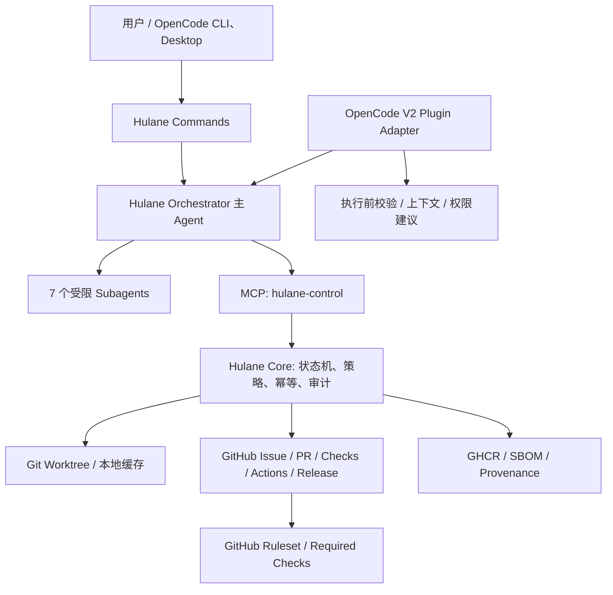
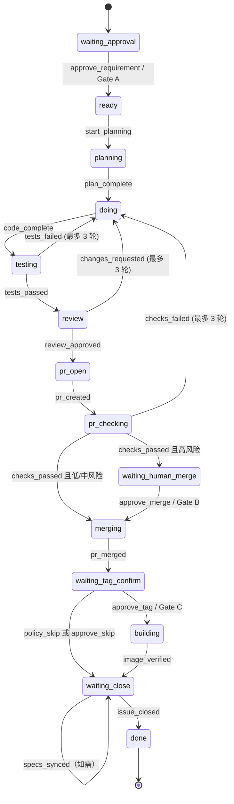

# Hulane OpenCode 独立重构项目——总体技术设计

> 文档编号：HOC-ARCH-001  
> 版本：V1.0（设计基线）  
> 编制日期：2026-11-10  
> 推荐新仓库：`hutong236/hulane-opencode`（已创建）  
> 源码基线：`hutong236/hutong-zcode-marketplace` / `hulane` / 插件版本 **3.10.0**（读取时 main 分支；实施前须固定源 commit SHA）  
> OpenCode 目标：**OpenCode V2**；插件 API beta，首次集成测试时固定 OpenCode 与 `@opencode/plugin` 精确版本  
> 状态：设计基线；后续实现状态以仓库 README 和 CI 为准

## 0. 摘要及核心决策

本项目**在独立 GitHub 仓库中重构 Hulane 为 OpenCode 原生研发工作流插件**，不是在旧 Marketplace 内新增一个简单的配置目录，也不是直接把 ZCode 的 Hook JSON 复制过去。新仓库拥有自己的源码、版本、Issue、CI、发布包；运行时读取和修改的是**用户当前开发项目对应的 GitHub 仓库**，不得错误写入旧 Marketplace。

核心决策：

1. **一次性移植并独立维护**。从旧仓库复制/提取经确认的 MIT 许可源码与相应声明，不使用运行时 git submodule、GitHub raw URL 或旧 Marketplace 作为生产依赖。未来上游同步采取人工审查的显式 Cherry-pick/补丁流程。
2. **控制平面中心化**。保留 `state-machine.mjs`、GitHub 状态协议、Worktree、Spec、Delivery 的稳定语义；重构 `hulane-control` 为可测试、可审计的独立 MCP 控制服务；所有受保护的写操作逐步迁入控制平面执行。
3. **OpenCode 原生入口**。安装器提供 `.opencode/commands/`、`.opencode/agents/`、`.opencode/skills/` 及 `opencode.jsonc`；原生插件以 `Plugin.define` 实现上下文提示、执行前校验、工具可见性和风险提示。不要假定 V1 Hook 名称与 V2 一一等价。
4. **GitHub 为业务事实源**。已创建的工单继续以目标仓库 Issue 受管评论、PR/Checks/Merge/Release/Actions/GHCR 为事实；`.hulane/state.json` 是可恢复缓存。离线未建 Issue 的工单，以本地持久化记录为暂时事实源，`flush` 后再进入 GitHub 权威状态。
5. **权限采用多层防护**。Agent 权限 + OpenCode V2 Policies + Plugin Hook + MCP 内部校验 + GitHub 分支保护/必需检查 + 独立凭据范围。不得将 Prompt 当作强制访问控制。生产环境高风险写入禁止直接依赖任意 Shell 命令。
6. **保留既有门禁语义，不偷偷改变用户流程**。默认低/中风险且范围清晰的 Gate A 同轮自动批准；高风险、范围不清、用户要求停等必须明确审批；高风险合并 Gate B 人工审批；确需 Tag/镜像交付 Gate C 人工确认；默认按需批量发版、一般工单可 `policy_skip`。

## 1. 背景与源系统事实核查

现有 `hulane/.zcode-plugin/plugin.json` 标识插件版本 3.10.0、MIT；`.mcp.json` 配置 `node ${ZCODE_PLUGIN_ROOT}/mcp/server.mjs`；Hook 配置为 `SessionStart`、`PreToolUse(Bash)`、`PreToolUse(Edit|Write)`、`Stop`。实际目录有 **10 个 commands、7 个 subagents、一个 skills/hulane-development/SKILL.md、MCP 服务、完整 Node.js 脚本和状态机**。

源代码真实入口及职责：

| 源文件/目录 | 已有能力（已核查） | 新版处理 |
|---|---|---|
| `hulane/mcp/server.mjs`、`mcp/tools.mjs`、`mcp/validate.mjs` | stdio MCP、工具声明、输入校验 | **复用协议语义，重构与兼容性测试** |
| `scripts/lib/state-machine.mjs` | 15 状态、事件、修订号、Done 不变量、三轮返工上限 | **保留语义，拆出纯状态域测试** |
| `scripts/lib/github-state.mjs` | Issue 受管评论、`hulane:` Label、Revision 守卫、Hydrate/Sync | 保留数据协议，增强并发与幂等 |
| `scripts/lib/authorization.mjs` | 短期一次性操作令牌；push/tag/merge/close 状态约束 | **将受保护命令改为受控执行 API**，兼容旧令牌阶段性过渡 |
| `scripts/lib/worktree.mjs`、`state-store.mjs` | 每工单 Worktree、本地 `.hulane` 状态与兼容 `.cmdb-dev` | 复用并修正路径/跨进程并发 |
| `scripts/lib/specs.mjs` | OpenSpec 增量与主规格一致性检查 | 保留 Gate 的证据链 |
| `scripts/lib/delivery.mjs`、`pr-checks.mjs` | Checks、Merged SHA、Actions/Release/GHCR/SBOM/Provenance 验证 | 保留并强化独立核验 |
| `hooks/{context,guard,discipline,stop}.mjs` | ZCode 专用输入输出及执行前拦截 | **不能直接迁移；拆出纯策略内核 + V2 Adapter** |
| `commands/*.md` | 10 个编排命令 | 内容迁移，替换专有路径/工具引用 |
| `agents/*.md` | 7 个专职子 Agent | Prompt 可继承，元数据和强制权限重写 |
| `templates/github-actions/*` | PR 必需检查及 Tag 镜像交付 | 适配新安装器，不改变目标仓库工作流含义 |

### 1.1 原工作流的关键事实

- `/hulane_dev` 采取 **local-first**：先开本地 `REQ/BUG` 工单，`issue_pending=true`、`issue_number=null`，在线时通过 `hulane_flush` 幂等创建/复用 GitHub Issue。
- 标准需求可使用 OpenSpec delta；实施时将决策史放到 `openspec/changes/archive/<ID>/`，把 delta 合并进主规格；Merge 后 `hulane_record_specs_synced` 使用 `merged_sha` 验证。
- 编码在 `.hulane/worktrees/<ID>`，Coder 是单写入者；Tester + Reviewer 可在权限隔离前提下并行检查；失败回退最多 3 轮。
- PR Merge 必须通过精确 PR head SHA 与 Checks 的验证；风险高时另需 Gate B。
- 默认 `delivery_required=false, skip_allowed=true`，允许合并后 `policy_skip`，不强迫每个 PR 立即构建镜像；`/hulane_release vX.Y.Z` 是无需工单的批量发版通道。
- 非临时的 `done` 须满足 Issue 已关闭及各阶段证据。较早记录存在 `legacy_completion` 兼容逻辑，不得伪造缺失证据。

## 2. 目标、边界和非目标

### 2.1 目标

- **功能等价**：10 命令与 7 Agent 在 OpenCode 可运行，含完整 Issue → Plan → Gate → Worktree → Code → Test/Review → PR/Checks → Merge → Release/Skip → Spec Sync → Close。
- **安全等价或更强**：原有无授权 push、绕过测试、假 Done、未确认 Tag/Close 的阻断仍有效；消除已知 Shell 解析绕过作为重要增强项。
- **运行独立**：安装或运行不依赖 `hutong-zcode-marketplace` 存在或可访问；不影响其发布节奏。
- **升级安全**：目标仓库现有 `.hulane/state.json`、历史 Issue 状态评论、在途 Worktree 可被读取且保持可恢复。
- **可维护**：Core、OpenCode Adapter、MCP、安装器、测试相互解耦；支持 macOS ARM64 与 Linux AMD64 的 Node.js/Bun/OpenCode 环境。

### 2.2 非目标

- 本项目**不直接创建 GitHub 新仓库**、不自动向旧仓库推送 PR，也不直接迁移用户现有业务仓库的 Issue。
- V1 不建设独立 Web 管理平台、不重写 GitHub Actions/GHCR、不支持 GitLab、不开发独立分布式调度集群。
- 不宣称 OpenCode 进程内 Hook 可以约束系统终端、GitHub UI 或其他外部工具。企业级强制门禁仍须仓库端 GitHub Rulesets/Required Checks 和最小权限凭据。
- 不默认为所有需求自动交付镜像；保留按需 Tag / 批量发布策略。

### 2.3 系统边界

| 实体 | 所属仓库/作用 | 说明 |
|---|---|---|
| 新插件源码 | `hutong236/hulane-opencode`（已创建） | 插件本身的代码、测试、版本、安装包 |
| 源项目 | `hutong236/hutong-zcode-marketplace` | 迁移时的**只读**源码基线，之后不作为运行依赖 |
| 业务开发仓库 | 用户打开的 GitHub 仓库（如 CMDB） | 产生 Issue/PR/Branch/Action/Release 的真实目标 |
| `.hulane/` | 业务仓库本地工作区 | 状态缓存、Worktree、令牌/锁；默认不提交 |
| GitHub | 业务仓库服务端 | 已上线工单权威状态和 CI 事实 |

## 3. 总体架构



组件分工：

1. **Command/Orchestrator** 解析用户意图、组织 Agent，并调用控制平面；不能直接伪造状态。
2. **Subagents** 分别规划、设计、设计评审、编码、测试、代码评审、构建核验；默认不接触有写入权限的 MCP 工具。
3. **OpenCode Adapter** 注册插件及运行时 Hook；给模型加载安全上下文；适配命令/Agent 配置；其 Hook 只是过程控制的一层。
4. **Hulane Core / MCP** 负责状态迁移、GitHub 写操作、授权、审计、不可绕过的不变量；脱离 LLM 也可独立测试。
5. **GitHub/CI** 提供可独立验证的不可替代事实，尤其分支保护和 Checks。

### 3.1 推荐新仓库结构

```text
hulane-opencode/
├── README.md
├── LICENSE                         # 保留源 MIT 许可与署名
├── CHANGELOG.md
├── package.json                    # Node >= 20；插件依赖版本锁定
├── pnpm-lock.yaml                  # 或 npm/bun lockfile；三选一
├── src/
│   ├── core/
│   │   ├── state-machine/          # 状态、事件、schema、校验
│   │   ├── github/                 # Issue/PR/Actions 数据访问
│   │   ├── worktree/               # 分支及工作树
│   │   ├── policy/                 # Gate、风险、授权、写操作策略
│   │   ├── specs/                  # OpenSpec 验证
│   │   ├── delivery/               # 镜像及证据核验
│   │   └── storage/                # revision、lock、投影
│   ├── mcp/
│   │   ├── server.mjs              # stdio MCP 服务
│   │   ├── tools.mjs
│   │   └── schemas/
│   ├── opencode/
│   │   ├── plugin.ts               # Plugin.define / V2 入口
│   │   ├── hooks/                  # context/tool checks
│   │   ├── config/                 # V2 config 及 schema
│   │   └── installer/              # install/uninstall/upgrade
│   └── cli/                        # 诊断与安装工具
├── assets/
│   ├── commands/                   # 10 个 .md
│   ├── agents/                     # 7 个 .md + orchestrator 定义
│   ├── skills/hulane-development/SKILL.md
│   └── templates/github-actions/
├── tests/
│   ├── unit/
│   ├── integration/
│   ├── security/
│   ├── compat/
│   └── e2e/
├── examples/target-repo/
├── docs/
│   ├── architecture.md
│   ├── development.md
│   ├── migration.md
│   ├── security.md
│   └── adr/
└── .github/workflows/
    ├── ci.yml
    ├── release.yml
    └── security.yml
```

> 结构是**目标设计**，不是现有目录。可先将源 JS 复制到 `src/core/legacy/` 做等价测试，再分批抽取，避免一开始大范围重写状态/策略相关逻辑而破坏行为。

## 4. OpenCode V2 接入设计

### 4.1 版本和 API 决策

本设计按 **OpenCode V2 当前官方文档** 编写：插件模块默认导出 `Plugin.define({ id, setup })`；包 SDK 示例使用 `@opencode/plugin`，而不是旧 V1 `@opencode/plugin` 的函数式 Plugin 实现，也**不能依据过期说明擅自写成 `@opencode/plugin`**。V2 官方明确标注 **beta**，因此项目 CI 必须固定并验证精确版本。

新旧差异需要显式处理：

| 维度 | OpenCode V2 设计要求 |
|---|---|
| 插件加载 | `plugins` 数组；本地文件或 npm 包，默认导出 `Plugin.define` |
| MCP | `mcp.servers.<id>`；`type:local`，`command: [...]`，`cwd`，`protocol` |
| 命令 | `.opencode/commands/*.md` 或 `commands` 配置 |
| Agent | `.opencode/agents/*.md` 或 `agents` 配置；`mode`、`steps`、`permissions` |
| Skill | `.opencode/skills/<name>/SKILL.md`，保留相对资源 |
| 权限 | `permissions: [{action,resource,effect}]`（注意 **复数**） |
| Policy | `policies: [{action:'tool.use',resource,effect}]`；权限之外的硬拒绝 |
| Hook | `ctx.session.hook('context', ...)`、`ctx.tool.hook('execute.before', ...)`，按文档确认其事件/异常语义 |

官方资料：<https://opencode.ai/docs/build/plugins/>、<https://opencode.ai/docs/migrate-v1>、<https://opencode.ai/docs/mcp-servers>、<https://opencode.ai/docs/agents>、<https://opencode.ai/docs/permissions>、<https://opencode.ai/docs/policies>。

### 4.2 安装交付模型

- **首版推荐 `install` 命令把项目级模板落在业务仓库 `.opencode/`**，包括 commands、agents、skills、最小配置；源码及 MCP Runtime 由安装的插件包/本机固定路径提供。
- 不让安装器覆盖业务仓库原有 `opencode.jsonc`；采用结构化合并、备份、幂等版本标识，并支持卸载仅删本产品管理的文件。
- 在 OpenCode 启动后使用 `opencode mcp list`、`opencode plugin list` 和最小 MCP 调用验证接入；不能仅检查配置文件存在。
- npm 包自动安装并不保证项目级 agents、commands、skills 一并自动发现，故**必须有安装器或显式插件注册机制**；这属于 P0 必测项。
- 保留命令 `/hulane_*`，不与 OpenCode 内建 `/init` 等名字冲突。

### 4.3 MCP 生命周期和隔离

- 使用 stdio，MCP 服务进程 `cwd` 必须绑定到当前**业务仓库工作区**，不能误设成插件仓库根目录。
- 不启用跨仓库共享的 MCP 进程池；源代码中存在 `process.cwd()`、仓库根查找、`.hulane` 状态访问，跨仓共用极易产生写错仓库风险。
- `protocol: legacy` 是初期最稳妥的兼容验证方式（老 server 的 `initialize`）；修复协议校验后可测试 `auto` / `2026-07-28`。对 `server/discover` 与 `initialize` 均设计联调用例。
- 默认 `codemode` 取官方运行时默认，若工具可见性影响 Agent 拒绝规则，则配置 `codemode: false` 并测试。不能依赖“隐藏工具名”实现授权隔离。
- MCP 写工具必须**在执行端**校验调用身份、仓库、状态、Worktree/分支、精确 SHA、期望 Revision，不能信任模型传入 `actor='orchestrator'` 就等于可信身份。

## 5. Commands 与 Agent 编排

### 5.1 10 个命令映射

| 旧命令 | V2 保留命令 | 作用 | 预期阶段 |
|---|---|---|---|
| `/hulane_check` | 同名 | 环境与 Ruleset/Checks 前置检查 | P0 |
| `/hulane_init` | 同名 | 目标业务仓库初始化与 CI 模板 | P0 |
| `/hulane_dev` | 同名 | 需求/缺陷开单、Planner、Gate A、进入研发 | P1 |
| `/hulane_approve` | 同名 | 异常/高风险 Gate A 审批后继续 | P1 |
| `/hulane_status` | 同名 | GitHub Refresh 与状态查看 | P0 |
| `/hulane_resume` | 同名 | 中断恢复、补做待办阶段 | P1 |
| `/hulane_flush` | 同名 | 离线工单在线建单与状态一次同步 | P1 |
| `/hulane_merge_approve` | 同名 | 高风险 Gate B | P2 |
| `/hulane_tag_approve` | 同名 | Gate C / Tag / Skip | P2 |
| `/hulane_release` | 同名 | 无工单的批量版本发布 | P2 |

Command 是编排入口，不得通过在 Prompt 里“直接写状态文件”绕过 MCP；每条命令必须清晰给出失败后的可恢复动作。

### 5.2 七个子 Agent 与权限

| Agent | 主要职责 | 原则权限 | 备注 |
|---|---|---|---|
| `hulane-planner` | 范围、验收、风险、Spec delta | 只读；拒绝 edit、受保护 Shell、写 MCP | 标准工单先读既有规格 |
| `hulane-designer` | 页面级方案、设计稿 | 仅批准的设计产物范围写入 | 非页面级或小单不启动 |
| `hulane-design-critic` | 设计质量审核 | 只读评估 | 设计稿评分不能替代 Gate A |
| `hulane-coder` | 实现和单元测试 | 仅指定 Worktree 写入 | 不允许 push/tag/merge/close |
| `hulane-tester` | 运行测试、产出证据 | 读 + 受限测试执行 | 不能修改业务实现，必要测试产物受限 |
| `hulane-reviewer` | 代码、Spec、风险审查 | 只读 | 禁止替 Coder 修复 |
| `hulane-build-checker` | 发布证据核验 | 只读 GitHub/Registry 事实 | 不能签发 Tag 或修改状态 |

增加 `hulane-orchestrator` **主 Agent** 负责状态推进、Agent 调度及审批，但控制平面仍必须单独验证每个动作。子 Agent 不能调用其他子 Agent；对可观察的任务调用关系进行执行期审计。

### 5.3 对关键元数据的转换

- 旧 ZCode Agent `maxTurns: 80` → OpenCode V2 `steps: 80`（应通过实际版本测试）。
- 旧 `tools: [Read, Edit, Bash, ...]` → 以 `permissions` 的 `read/edit/shell/subagent` 权限规则表达；不得新旧字段混用。
- 旧 `injectAgentsMd: true` → 通过项目 `AGENTS.md`/OpenCode 规则或插件上下文实现，而非继续传旧字段。
- 旧 `skills:`/`argument-hint:` 的扩展元数据并非 V2 通用契约，命令正文显式要求 Skill 或通过插件注入；`$ARGUMENTS` 可保留但需命令测试。

## 6. 研发状态机与事实源

### 6.1 保留的 15 个状态

`waiting_approval`、`ready`、`planning`、`doing`、`testing`、`review`、`pr_open`、`pr_checking`、`waiting_human_merge`、`merging`、`waiting_tag_confirm`、`building`、`waiting_close`、`blocked`、`done`。



`blocked` 是支持记录阻断和恢复的异常态，**不把它画成任何状态都能直接无条件跳回的状态**，实际 `resume` 要遵守源状态机的恢复规则。`issue_created` 为 `issue_pending` 的绑定自环，不改变主状态。`checks_passed` 必须由验证 PR Checks 的专用接口触发，而非泛用 transition。

### 6.2 GitHub 事实与状态优先级

1. 有 Issue 时，GitHub 受管评论（标记 `<!-- cmdb-dev-state:v2 -->`，`cmdb-state` JSON）和真实 Issue/PR/Actions 等事实是权威。
2. 同一个工单的状态必须维护单调递增 `revision`；发现远端版本更高或同 Revision 内容不同，写入拒绝并先 Hydrate。
3. `.hulane/state.json` 与 `plan/` 是本地缓存和只读 Obsidian 投影，允许删除后从 GitHub 恢复。
4. `issue_pending=true` 时 GitHub 尚无对象：本地是暂时真相；`hulane_flush` 需根据标题前缀幂等查重、回填 `issue_number`、一次同步。
5. 兼容既有 `cmdb-dev-state:v2` 标记、`cmdb/req-*` 分支和 `.cmdb-dev/` 状态目录（**不对在途 Worktree 执行自动 mv**）。新项目尽量维持 `.hulane` 标识不变。

### 6.3 多进程并发改进（相比源实现的新增设计）

单 Agent 写入原则不足以覆盖多个 OpenCode 实例、OpenCode+ZCode 混用、独立 CLI 以及脚本自动化。建议：

- 本地事务：以项目根实际规范化路径作为锁域，文件锁 / 原子目录锁保护 `REQ/BUG` 计数器、`state.json` 与临时操作凭据；要求跨进程有效，超时错误可诊断。
- 远端事务：Issue Comment PATCH 使用读取-校验-写后再读验证策略；GitHub API 若不能提供原子 CAS，不得宣称完美防竞态。对于同一工单严格执行**单协调者策略**（lease / owner + expiry），并可对远端冲突强制人工协调。
- 事件幂等：`event_id`、`expected_revision`、请求指纹及 GitHub 关联对象编号；重复 Flush/PR/Tag/Issue Close 必须检测并拒绝第二次副作用。
- 断电恢复：原子写状态文件、追加审计事件、持久化中间结果；不可保证“写 GitHub 与写本地文件”跨系统原子，使用补偿/重试事务。

## 7. Gate A/B/C 与权限安全

### 7.1 Gate A：需求批准

| 情况 | 行为 |
|---|---|
| Low/Medium、范围清晰、用户未要求暂停 | 允许 `auto_intake` 同轮批准，保留用户原始意图、完整审批包及来源 |
| 用户明示“直接做/预授权”且非高风险 | `pre_authorized`，记录真实人类身份及引文 |
| High Risk / scope_questions 不清 / 用户明确暂停 | 停在 `waiting_approval`，需要 `/hulane_approve` |
| Standard 业务需求需要 Spec | Gate A 审批包包含 delta/验收场景；不因需 Spec 默认中断 |

注意：**自动批准不是无条件越权**；审批包必须先完整持久化/在线时发布到 Issue。离线创建时排队同步，发布前应补齐审批证据。

### 7.2 Gate B：高风险合并

- 高风险合并必须经 `/hulane_merge_approve`，不因 V2 的 `--auto`/自动允许权限请求而跳过。
- 所有 PR 必须持有 `pr_head_sha`、`pr_check_name`、`pr_check_run_url`、代码评审结论与至少一个可信 Merge Guard。
- 对公有仓库优先使用 GitHub required status checks / Rulesets；对不支持服务端强约束的私有仓库，旧版的 `control_plane_verified` 是**补偿控制，不等于服务端绝对禁止绕过**，要显著标明安全降级并拒绝无强制约束的无人值守高风险合并。
- Merge 使用钉死的 head SHA，防止检查与合并之间的 TOCTOU。

### 7.3 Gate C：版本/镜像交付

- 默认 `delivery_required=false`、`skip_allowed=true`：PR 合并后 `policy_skip`，Spec 校验通过后关闭 Issue；镜像留待未来 `/hulane_release` 批量交付。
- 只有要求单工单发版才进入 Tag 交付，需要人类确认版本（严格 SemVer）、确认目标 merged SHA 和 Tag 不冲突。
- Tag 是 annotated tag；Tag 对象 SHA 与 commit SHA 分离校验。未经确认不得创建/推送 Tag。
- 交付证据必须独立验证：Actions Run、Release Metadata、GHCR Digest、SBOM、Provenance，缺失即不能 `image_verified`。
- `/hulane_release vX.Y.Z` 不建工单，必须钉死 origin 默认分支当前 SHA，并列出上次 Tag 以来合并批次；Tag 需双方令牌或受控执行端保护。

### 7.4 受保护命令的推荐执行模型

建议新增控制平面工具（**目标接口，尚未实现**）：`hulane_push_branch`、`hulane_merge_pr`、`hulane_create_tag`、`hulane_push_tag`、`hulane_close_issue`、`hulane_release_batch`。每一个都在服务端执行仓库身份校验、状态校验、路径校验、精确 SHA/Issue/PR 匹配和审计写入，Agent 不能改参数绕过。旧 `hulane_authorize` 仅保留迁移兼容或可信本地场景。

OpenCode 上层使用 `permissions` 限制 Agent，`policies` 硬阻断已知 `shell:git push *`、`shell:gh pr merge *` 等形式，`execute.before` 检查危险工具输入；**这仍不能保证抵御以 `node -e`、`python -c`、`gh api`、子进程间接执行的绕过**。关键资产访问应通过只授予控制平面 GitHub Token、Agent 执行环境没有推送/合并凭据、GitHub Rulesets、隔离容器来保证。

### 7.5 机密数据和审计

- Token/授权凭据不进入 Issue 评论、Agent Prompt、日志、模型上下文、错误堆栈或仓库提交；本地短期凭据 `0600`。
- 必填审计：`event_id`、时间、work_item_id、actor/source、业务仓库、预期与实际 revision、操作、精确 commit SHA、审批来源、CI URL、结果/错误、Plugin 版本。
- GitHub App/最小权限 Token 优先；`gh auth` 作为开发期方案；凭据最好只暴露给 MCP 控制服务。
- 对来自 GitHub Issue/PR 的用户内容视为不可信输入，不能允许其直接改变系统权限/门禁。

## 8. Worktree、OpenSpec 与 GitHub Actions 设计

### 8.1 Worktree

- 每个 Work Item 一个隔离 Worktree：`.hulane/worktrees/<ID>`；基线必须从 `origin/<实际默认分支>`，而不是写死 main。
- 创建前检查 repo root、existing branch、dirty worktree、符号链接、路径逃逸和当前登录身份。
- 只有同 Work Item 的 Coder 可以写入；Reviewer 与 Designer Critic 只读；Tester 可运行检查但不能修改业务源码。
- 合并后普通 `git worktree remove`、`git branch -d`；如 Worktree 非干净，保留并报告，不自动 `--force`。

### 8.2 OpenSpec

- 现有主规格：`openspec/specs/<capability>/spec.md`；增量与历史：`openspec/changes/archive/<ID>/`。
- 标准业务行为变更默认 `spec_sync_required=true`；`small` 始终 false；纯文档/基础设施的显式豁免必须留痕。
- Coder 在 PR 中完成 delta → main spec 合并；Merge 后通过 `hulane_record_specs_synced` 验证 `specs_commit_sha == merged_sha`，通过才允许 Close。
- 检查仅触及已批准 capability；不能用未核验的 `specs_synced=true` patch 绕过。

### 8.3 CI/CD

- 新插件自身仓库运行：unit、lint、typecheck、security、MCP protocol、安装/卸载、macOS/Linux 集成、版本兼容测试、发布包校验。
- 业务仓库通过安装器获得 `Hulane PR Checks / verify` 和选用的 tag-only 镜像工作流；默认只构建镜像于 tag 事件，避免每次 PR 同步改镜像。
- GitHub Actions 权限最小化；依赖固定版本/校验；避免 fork PR 访问生产 Secrets；GHCR 推送只授权 Tag 工作流。

## 9. 非功能要求

| 项目 | 设计目标 / 验收判断 |
|---|---|
| 兼容性 | Node.js >=20、macOS arm64、Linux amd64；测试锁定 OpenCode V2 精确版本 |
| 一致性 | 同一工单并发写不得静默覆盖，冲突可诊断并可恢复 |
| 幂等性 | `init`、`flush`、`resume`、重复状态查询不重复创建 Issue/PR/Tag |
| 安全性 | 高风险 Gate 不得绕过；无凭据 Agent 无法自行写 GitHub 受保护资源 |
| 可恢复性 | 在线工单本地缓存删除后，可从 GitHub 恢复；离线工单写入持久化失败必须显式报错 |
| 可观测性 | 每个阶段有稳定错误码、关联 ID、结构化日志和审计记录 |
| 性能 | P0 以正确性优先；设本地单次命令与 MCP RPC 预算并测试，不承诺未经测量的延迟 |
| 供应链 | 锁版本、生成 SBOM、依赖扫描、标注原 MIT 源码归属 |
| 演进 | V2 插件 SDK beta 变更时，有单独 Adapter 回归测试，不影响核心状态机 |

## 10. 兼容迁移及验收原则

### 10.1 源码迁移策略

- 给旧仓库 `main` 固定来源 SHA，创建 `UPSTREAM_SOURCE.md`：源 URL、源版本 3.10.0、SHA、迁入文件清单、许可证及改动说明。
- 先复制 Core/MCP/测试；对 Core 建**行为等价基线测试**；完成后再切换 OpenCode Adapter。
- 新仓库版本从 `0.1.0` 开始独立计数，不把旧 3.10.0 冒充为 OpenCode 可用版本。
- 不要求对旧 ZCode CLI 兼容；但目标业务仓库既有 GitHub 评论/`.hulane` 数据为必须兼容的**数据协议**。

### 10.2 最低发布验收

1. `/hulane_check`、`/hulane_init`、`/hulane_status` 能正常工作，MCP 工具列表和实际调用成功。
2. 10 个命令、7 个 Agent 全部有定义、权限与冒烟测试；Orchestrator 能调度但子 Agent 不能越权。
3. 离线开单 → 重启 → 在线 Flush 只生成一个 Issue；重复调用不重复建单。
4. `waiting_approval` 高风险未批准时，不能建 Worktree、写业务代码、合并 PR。
5. 对允许的低/中风险需求能完成一次端到端执行、CI 验证并合并；PR SHA 变化使之前的 Checks 证据失效。
6. 高风险合并、Tag/镜像交付分别守住 Gate B、Gate C；策略 Skip 符合源逻辑。
7. 目标业务仓库旧状态评论及 `.hulane` 可读，不破坏现有 Worktree；并发冲突拒绝覆盖。
8. 未完成的 OpenSpec 同步不能 Close；没有交付核验不能伪造 `image_verified`。
9. 负向安全用例（Shell 包装、`gh api`、修改 Hook、禁用插件、子 Agent 直接调用写 MCP）不能产生无授权合并或发布。
10. 从打包安装的插件而非仅源码工作区测试一次成功，才发布稳定版。

## 11. 风险与设计裁决

| 风险 | 严重性 | 裁决 |
|---|---|---|
| OpenCode V2 插件 API beta 变更 | 高 | 锁版本 + Adapter 隔离 + CI 升级矩阵 |
| ZCode Hook 与 OpenCode 执行钩子语义不同 | 高 | 不复制 Hook JSON；迁移策略内核、负向集成测试 |
| 权限/Hook 可被模型绕过 | 高 | 控制平面执行特权操作 + GitHub Rulesets + 分离凭据 |
| 两客户端并发推进同一工单 | 高 | 本地锁 + 远端 Lease/Revision 校验 + 人工冲突处理 |
| GitHub/本地无法原子提交 | 中高 | 事件幂等、阶段恢复、补偿处理，禁止假 Done |
| Node/Bun/MCP 启动 cwd 不一致 | 高 | 显式业务仓库 cwd + 多仓错写测试 |
| 复制上游代码后许可证丢失 | 中 | 保留 MIT LICENSE、署名和 UPSTREAM_SOURCE |
| 客户端自动安装/热更新行为差异 | 中 | 以实际安装包做 E2E，记录固定版本与升级流程 |

## 12. 交付清单及开放决策

本设计对应开发交付：独立源码仓库、V2 插件包、安装/卸载 CLI、10 命令、7 Agent、1 主编排 Agent、MCP 控制服务、兼容 schema、目标业务仓库模板、自动化测试、安全测试、操作手册与 Release。

实施前必须固定：**源 commit SHA**、**OpenCode V2 精确版本**、**包管理器与锁文件**、**首版发布渠道（本地安装/npm）**、**控制平面持有的 GitHub 凭据模式**、**是否允许旧 ZCode 与新 OpenCode 同时操作同一个业务仓库**。默认按最安全值：禁止同一个 Work Item 的两个控制客户端并行写入。

## 13. 参考资料与出处

### 现有 Hulane 真实源码（源事实）

- <https://github.com/hutong236/hutong-zcode-marketplace/tree/main/hulane>
- <https://github.com/hutong236/hutong-zcode-marketplace/blob/main/hulane/README.md>
- <https://github.com/hutong236/hutong-zcode-marketplace/blob/main/hulane/docs/V2_ARCHITECTURE.md>
- <https://github.com/hutong236/hutong-zcode-marketplace/blob/main/hulane/docs/GITHUB_STATE_PROTOCOL.md>
- <https://github.com/hutong236/hutong-zcode-marketplace/blob/main/hulane/scripts/lib/state-machine.mjs>
- <https://github.com/hutong236/hutong-zcode-marketplace/blob/main/hulane/hooks/hooks.json>

### OpenCode 官方文档（V2 接口事实；2026-11-10 查阅）

- <https://opencode.ai/docs/build/plugins/>
- <https://opencode.ai/docs/build/plugins/migrate-v1/>
- <https://opencode.ai/docs/migrate-v1>
- <https://opencode.ai/docs/mcp-servers>
- <https://opencode.ai/docs/agents>
- <https://opencode.ai/docs/commands>
- <https://opencode.ai/docs/skills>
- <https://opencode.ai/docs/permissions>
- <https://opencode.ai/docs/policies>

> 说明：**“源事实”**仅表示已从现有仓库代码中核实；**“目标设计”**为新项目建议，不表示这些 API 和安全特性已经实现。特别是插件 SDK beta 的接口和 OpenCode 安全边界，必须通过锁定版本的运行测试确认。