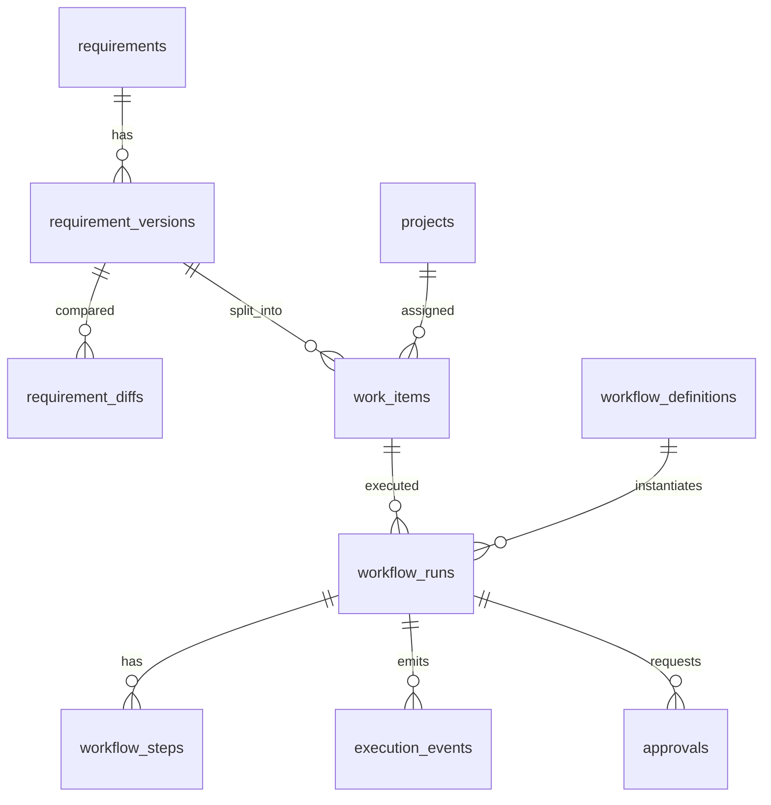

# WB-002 SQLite storage (draft checkpoint)

This package is the **workbench-wide** database, separate from Hulane's per-repository `.hulane/state.json`, GitHub Issue/PR and Worktree state. No code in this package reads or overwrites Hulane's internal files.

- Storage: Node 20/22-compatible `better-sqlite3` driver; application-data directory, WAL journal, foreign keys, configurable busy timeout.
- Data model: projects, requirements, immutable requirement_versions, requirement_diffs, work_items, versioned workflow_definitions, workflow_runs, workflow_steps, execution_events and approvals.
- Migration: immutable SHA256-checked schema history, serial `BEGIN IMMEDIATE` migrations, transactional rollback, safe refusal of downgrade or altered migration.
- API: `WorkbenchDatabase` transaction helper, `projects.create/find/updateName` with optimistic CAS revision, async SQLite online backup.
- Security: rejects database symlinks and relative paths; database is opened solely from the configured app-data directory; never mix project source files with database state.
- Tests: fresh/restart, constraints, transaction rollback, migration failure/retry, CAS conflict, online backup, unsafe directory input.

## ERD (simplified)



## Usage

```ts
import { WorkbenchDatabase } from '@hulane/workbench-database';

const storage = new WorkbenchDatabase();
const project = storage.projects.create({ slug: 'cmdb', name: 'CMDB', repoRoot: '/absolute/path' });
await storage.backup();
storage.close();
```

The repository root is still considered user data: project registration / Git validation is a separate WB-004 security boundary. Database migrations are forward-only by design; rollback means a failed migration rolls back its transaction. Existing deployed data requires backup + restore rather than destructive down-migration.

**Verification status:** pinned dependency lockfile was generated by the Node 20 GitHub Runner. CI is now restored to `npm ci` and requires successful Node 20/22 tests before closing Issue #6.
